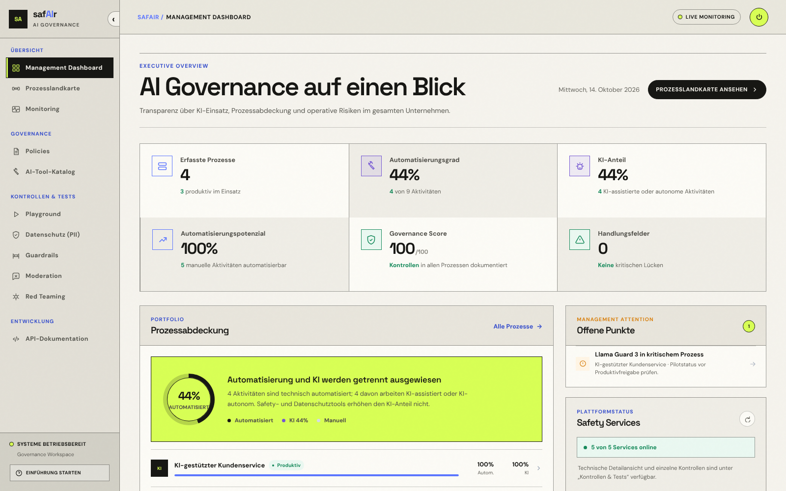
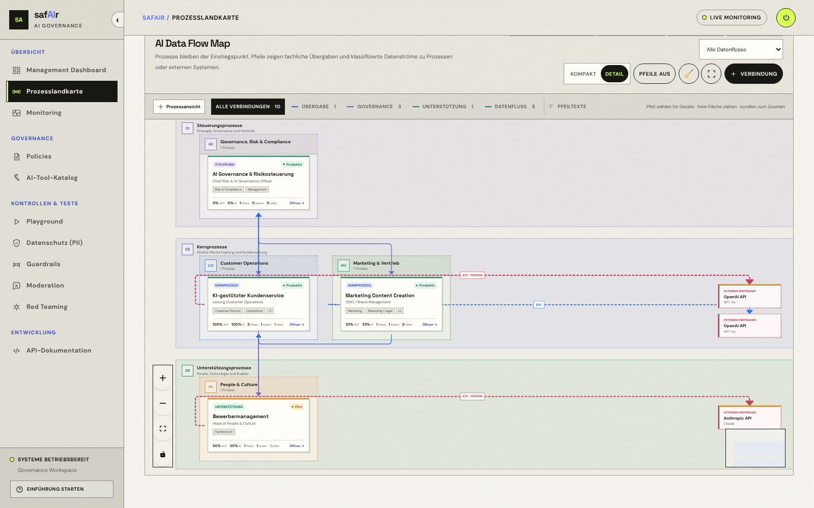
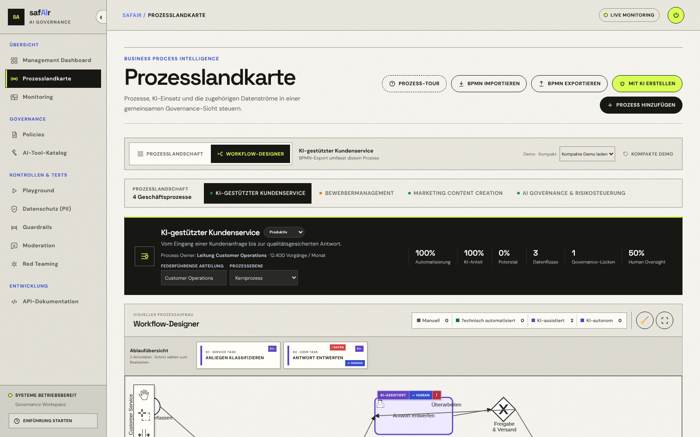
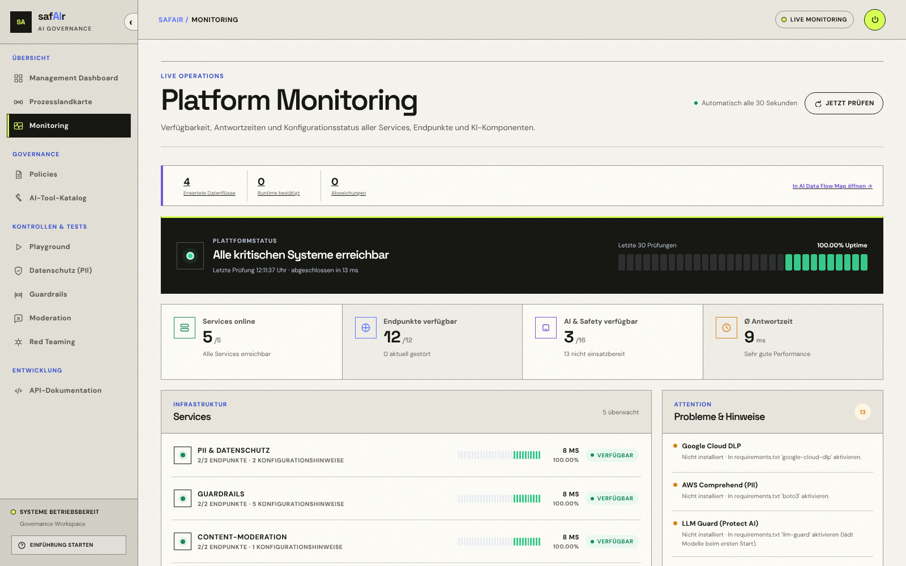

<div align="center">

# safAIr

**Plattform für sichere, nachvollziehbare und datenschutzfreundliche AI-Workflows in Unternehmen.**

[](https://github.com/P-hinn/safeAIr/actions/workflows/ci.yml)


[](#lokal-starten)

[Architektur](docs/architecture.md) · [Tool-Matrix](docs/tools.md) · [Lokal starten](#lokal-starten) · [API](#api)

</div>

safAIr bündelt PII-Erkennung und Anonymisierung, Guardrails, Content-Moderation, Red Teaming und die Orchestrierung von LLM-Anfragen hinter einer gemeinsamen Weboberfläche und API. Sicherheitsrichtlinien werden zentral gepflegt, Engines pro Request gewählt und alle Services über ein integriertes Monitoring beobachtet. Dazu kommt eine Prozesslandkarte mit BPMN-Editor, in der sich AI-Einsatz entlang der Geschäftsprozesse dokumentieren und bewerten lässt.



## Funktionsumfang

| Bereich | Was es kann |
|---|---|
| **Management-Dashboard** | Überblick über Services, Policies, AI-Inventar und Prozessabdeckung |
| **Prozesslandkarte** | Prozesse nach Bereichen und Ebenen visualisieren, BPMN 2.0 importieren/exportieren (bpmn-js), AI-Einsatz und Risiken pro Aktivität annotieren; Prozessentwürfe per LLM aus Text oder Spracheingabe generieren |
| **PII & Datenschutz** | Personenbezogene Daten mit Presidio oder Scrubadub erkennen und anonymisieren; Adapter für Google Cloud DLP und AWS Comprehend |
| **Guardrails** | Prompts und Modellantworten auf Prompt Injection, Jailbreaks und Secrets prüfen; regelbasierte Engine plus Adapter für LLM Guard, NeMo Guardrails und Lakera Guard |
| **Content-Moderation** | Inhalte mit Llama Guard 3 (via Ollama) klassifizieren |
| **Red Teaming** | Promptfoo- und Garak-Läufe aus festen Presets starten und verfolgen |
| **Orchestrierung & Playground** | Policies verwalten und Chat-Anfragen inkl. Verlauf durch die Pipeline *PII → Guardrails → Moderation → LLM → Output-Prüfung* schicken – mit vollständigem Trace pro Schritt. Provider: Ollama, OpenAI, Anthropic |
| **Monitoring** | Verfügbarkeit, Latenzen, Endpoint-Historie und AI-Inventar aller Services |

### Screenshots

| Prozesslandkarte – AI Data Flow Map | Workflow-Designer (BPMN) |
|---|---|
|  |  |

| Platform Monitoring |
|---|
|  |

## Architektur

```text
                ┌──────────────────────────────┐
                │ Web-App                      │
                │ Nuxt 4 · Vue 3 · TypeScript  │
                └──────────────┬───────────────┘
                               ▼
                ┌──────────────────────────────┐
                │ API-Gateway                  │
                │ Fastify · Auth · OpenAPI     │
                └──────────────┬───────────────┘
      ┌──────────────┬─────────┼──────────┬──────────────┐
      ▼              ▼         ▼          ▼              ▼
┌───────────┐ ┌───────────┐ ┌──────────┐ ┌──────────┐ ┌──────────────┐
│ PII       │ │ Guardrails│ │Moderation│ │ Red Team │ │ Orchestrator │
│ Presidio  │ │ Heuristik │ │Llama     │ │ Promptfoo│ │ Policies ·   │
│ Scrubadub │ │ + Adapter │ │Guard     │ │ Garak    │ │ LLM-Pipeline │
└───────────┘ └───────────┘ └──────────┘ └──────────┘ └──────────────┘
```

| Komponente | Stack | Port | Aufgabe |
|---|---|---:|---|
| [`apps/web`](apps/web) | Nuxt 4, Vue 3, TypeScript, Vue Flow, bpmn-js | 3000 | Weboberfläche, Login, Prozesslandkarte |
| [`services/gateway`](services/gateway) | Node.js 22, Fastify 5 | 8080 | Einziger Einstiegspunkt: Auth, Routing, OpenAPI/Swagger, Monitoring |
| [`services/pii-service`](services/pii-service) | Python, FastAPI, Presidio, spaCy | 8001 | PII-Erkennung und Anonymisierung |
| [`services/guardrails-service`](services/guardrails-service) | Python, FastAPI | 8002 | Prüfung von Prompts und Modellantworten |
| [`services/moderation-service`](services/moderation-service) | Python, FastAPI | 8003 | Content-Moderation über Llama Guard |
| [`services/redteam-service`](services/redteam-service) | Python, FastAPI, Node.js | 8004 | Red-Teaming-Jobs mit Promptfoo oder Garak |
| [`services/orchestrator`](services/orchestrator) | Python, FastAPI, SQLite | 8005 | Provider, Policies, sichere LLM-Pipeline, Prozessgenerierung |

Designentscheidungen:

- **Ein Service pro Safety-Domäne** – unabhängig deploy- und austauschbar, jeweils mit `GET /health` und versionierter API (`/v1/...`).
- **Python, wo die Safety-Libraries leben** (Presidio, LLM Guard, NeMo, …), **TypeScript für Gateway und Frontend**.
- **Engine-Abstraktion** – jede Analyse-Domäne hat ein gemeinsames Interface; die Implementierung wird per `engine`-Parameter gewählt. Optionale Engines bleiben deaktiviert, bis Abhängigkeiten und Credentials vorhanden sind – der Basis-Stack läuft ohne Cloud-Zugänge.
- **Gateway als einzige öffentliche Schnittstelle** – die Services sind nur im internen Netz erreichbar.

Details: [Architekturdokumentation](docs/architecture.md) · [Tool-Matrix](docs/tools.md)

## Lokal starten

Voraussetzung: Docker mit Docker Compose.

```bash
cp .env.example .env
# in .env: SITE_PASSWORD (mind. 12 Zeichen) und SESSION_SECRET setzen,
# z. B. SESSION_SECRET=$(openssl rand -base64 48)
docker compose up --build
```

| Dienst | URL |
|---|---|
| Weboberfläche | <http://localhost:3000> |
| Swagger UI | <http://localhost:8080/docs> |
| OpenAPI JSON | <http://localhost:8080/openapi.json> |
| Gateway Health | <http://localhost:8080/health> |

> [!IMPORTANT]
> Ohne `SITE_PASSWORD` (≥ 12 Zeichen) und `SESSION_SECRET` (≥ 32 Zeichen) verweigern Web-App und Gateway den Zugriff. LLM-Provider (`OPENAI_API_KEY`, `ANTHROPIC_API_KEY`, `OLLAMA_URL`) und optionale Engines werden in `.env` aktiviert – alle Variablen sind in [`.env.example`](.env.example) dokumentiert.

### Entwicklung ohne Docker

Web-App und Gateway lesen die Variablen aus der Umgebung; am einfachsten vorher die `.env` exportieren (`set -a; source .env; set +a`) und die Service-URLs auf `http://localhost:<port>` setzen.

```bash
# Web-App
cd apps/web && npm install && npm run dev

# Gateway
cd services/gateway && npm install && npm run dev

# Python-Services (Beispiel PII; die anderen analog auf ihrem Port)
cd services/pii-service
python -m venv .venv && source .venv/bin/activate
pip install -r requirements.txt
python -m spacy download en_core_web_sm
python -m spacy download de_core_news_sm
uvicorn app.main:app --reload --port 8001
```

### Tests

```bash
cd apps/web && npm run typecheck && npm test
cd services/gateway && npm run build
cd services/orchestrator && pip install -r requirements-dev.txt && pytest
```

Die Checks laufen auch per [GitHub Actions](.github/workflows/ci.yml).

## API

Alle Endpunkte laufen über das Gateway. Die vollständige OpenAPI-3-Spezifikation mit Schemas, Beispielen und Fehlercodes liefert die Swagger UI unter `/docs`. Web-App und API teilen sich dieselbe signierte Session.

| Methode | Pfad | Beschreibung |
|---|---|---|
| `GET` | `/health` | Aggregierter Status aller Services |
| `GET` | `/monitoring` | Verfügbarkeit, Latenzen und AI-Inventar |
| `GET` | `/api/pii/v1/engines` | Verfügbare PII-Engines und Status |
| `POST` | `/api/pii/v1/analyze` | Personenbezogene Daten erkennen |
| `POST` | `/api/pii/v1/anonymize` | Personenbezogene Daten anonymisieren |
| `GET` | `/api/guardrails/v1/engines` | Verfügbare Guardrail-Engines und Status |
| `POST` | `/api/guardrails/v1/scan/prompt` | Eingabe-Prompt prüfen |
| `POST` | `/api/guardrails/v1/scan/output` | Modellantwort prüfen |
| `POST` | `/api/moderation/v1/moderate` | Inhalt moderieren |
| `GET` | `/api/redteam/v1/tools` | Red-Teaming-Tools und Status |
| `GET` | `/api/redteam/v1/presets` | Erlaubte Scan-Presets |
| `POST` | `/api/redteam/v1/scans` | Red-Team-Scan aus einem Preset starten |
| `GET` | `/api/redteam/v1/scans/{id}` | Status und Ergebnis eines Scans |
| `GET` | `/api/orchestrator/v1/providers` | Provider und Modelle auflisten |
| `GET` · `POST` · `PUT` · `DELETE` | `/api/orchestrator/v1/policies` | Sicherheitsrichtlinien verwalten |
| `POST` | `/api/orchestrator/v1/chat` | Anfrage durch die Safety-Pipeline schicken |
| `POST` | `/api/orchestrator/v1/processes/generate` | BPMN-Prozessentwurf per LLM erzeugen |
| `POST` | `/api/orchestrator/v1/audio/transcriptions` | Spracheingabe transkribieren |

Beispiel:

```bash
curl -X POST http://localhost:8080/api/pii/v1/anonymize \
  -H 'Content-Type: application/json' \
  -b 'safair_session=…' \
  -d '{"text": "Max Mustermann, max@example.com", "language": "de", "engine": "presidio"}'
```

## Sicherheit

- **Ein Eintrittspunkt:** Nur Web-App und Gateway sind erreichbar; die internen Services laufen ohne eigene Auth im privaten Netz.
- **Session:** HMAC-signiertes Cookie mit eigenem `SESSION_SECRET`, `HttpOnly`, `SameSite=Strict`, timing-sichere Vergleiche, Login-Rate-Limit.
- **Red Teaming:** keine freien CLI-Argumente, nur validierte Presets; maximal zwei parallele Läufe.
- **Pipeline:** Auch der vom Client gesendete Chat-Verlauf durchläuft PII- und Guardrail-Prüfung; eingebaute Policies sind schreibgeschützt.
- **Secrets** nur über Umgebungsvariablen, nie im Repository.

Bekannte Grenzen (gemeinsames Passwort statt Benutzerverwaltung, In-Memory-Jobs, SQLite) sind in der [Architekturdokumentation](docs/architecture.md#bekannte-grenzen) beschrieben.

## Deployment

[`.do/app.yaml`](.do/app.yaml) enthält eine vollständige Spezifikation für die DigitalOcean App Platform: alle sieben Komponenten, pfadbasiertes Ingress auf einer Origin, Health Checks pro Service und Secrets ausschließlich als verschlüsselte Runtime-Variablen.

```bash
doctl apps create --spec .do/app.yaml --upsert
```
